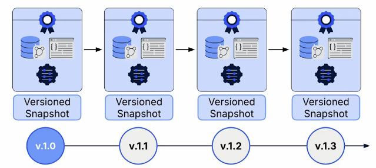
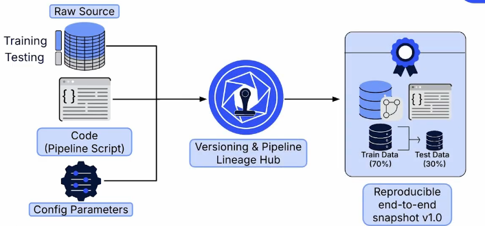
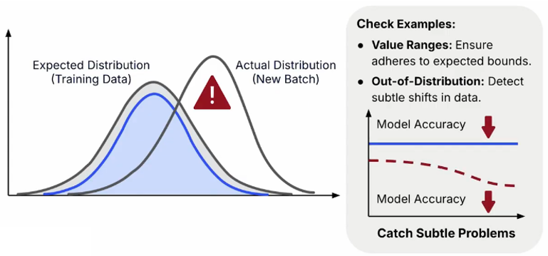

# ML Data Ingestion & Validation
A ML model is only as good as the data you feed it. Building a robust and trustworthy ML system requires a disciplined approach to how you collect, track, and verify your data. This process combines three core principles: **ingestion**, **versioning**, and **validation**.

**Data Traceability (MLOps)**: Traceable, reproduciable, verifiable ML datasets.

High-quality data collection:
* Prove where the data was collected.
* Reproduce how it was collected.
* Detect when it changes silently.

## 1. Data Ingestion
Data ingestion is the process of creating automated, configuration-driven pipelines to systematically import and prepare datasets for use in a machine learning system.

Instead of relying on manual downloads, which are difficult to trace, configuration-driven ingestion defines all data collection parameters, such as API endpoints, dates, and source files, in an external configuration file. This makes the process repeatable and transparent.

After fetching the data, an untouched raw snapshot is saved as an immutable baseline. This serves as a primary artifact that can always be referenced or restored when needed.

## 2. Data Versioning
Data versioning tracks changes to datasets over time, similar to how Git tracks code. It involves saving snapshots of data and capturing the exact recipe used to create it, including the raw source, ingestion scripts, and configuration parameters.

Each dataset version is linked to the code, configurations, and model training runs that used it. This enables reproducibility, comparison between versions, and rollback when errors occur. Tools like DVC (Data Version Control) help manage dataset versions alongside Git.

Data versioning tells you what the data was at a given point.

## 3. Data Lineage
Data lineage provides a complete audit trail of data throughout its lifecycle, documenting its origin, movement, and transformations from the raw source to the final features used for model training.

It involves preserving an untouched, immutable snapshot of the raw data and tracking the code, configurations, and transformations applied at each processing step, along with the outputs produced.

This ensures transparency, traceability, and reproducibility. If a model's performance suddenly drops, data lineage helps identify the exact change in the data pipeline responsible, making debugging easier.

Data lineage tells you how it got there.

## 4. Data Validation
Data validation ensures data quality before it reaches a model by enforcing predefined rules and checking both structural integrity and statistical properties. It acts as a quality gate, catching errors early to prevent flawed data from affecting model training, wasting computational resources, or degrading model performance.

In production pipelines, data validation should run automatically immediately after ingestion and before any transformation or training begins, ensuring that only validated data proceeds through the pipeline.

### 4.1 Structural Validation
Structural validation enforces a predefined schema to ensure data follows the expected structure and rules. It checks:

- **Data types**: Values have the correct types (e.g., integers, strings).
- **Completeness**: Required columns and fields are present.
- **Consistency**: Data follows expected formats and rules.

For example, if a model expects a numeric price column, structural validation rejects data containing text values in that column.

### 4.2 Statistical Validation
Statistical validation checks whether data follows expected distributions and value ranges. It identifies:
* **Value ranges**: Values falling outside expected limits.
* **Distribution shifts**: Significant changes in the spread or distribution of data.
* **Anomalies**: Unusual values or patterns that may indicate data quality issues.

These checks detect subtle problems that may not cause pipeline failures but can gradually degrade model performance.

### 4.3 Common data validation tools
* Great Expectations
* Pydantic
* Pandera
* Cerberus