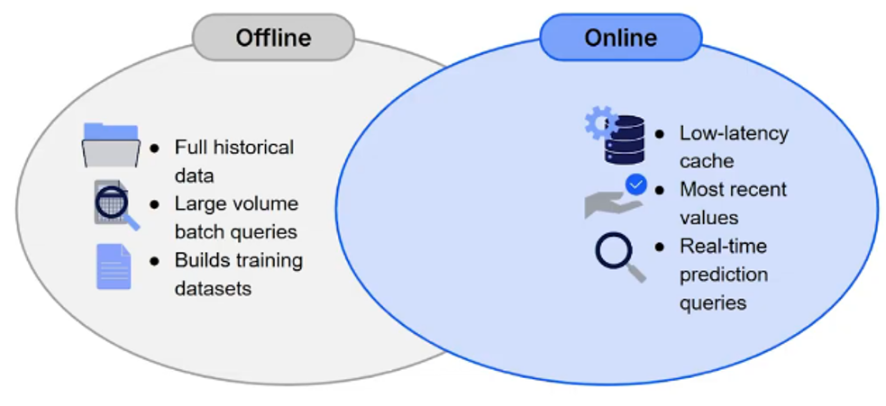
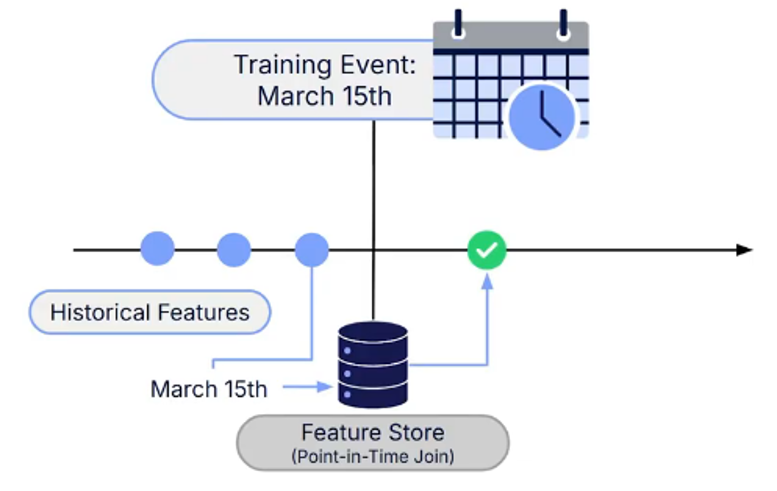

# Centralized Feature Stores
## 1. Train-Serve Skew
Train-serve skew occurs when the features a ML model receives during production differ from those used during training, causing its performance to degrade despite performing well during development.

This discrepancy typically arises because training pipelines, which process static historical data, and serving pipelines, which handle live prediction requests, are developed and maintained separately.

For example, a training pipeline might calculate a customer's average purchase value over a 30-day window, while the serving pipeline calculates the same feature using only a 7-day window. As a result, the model receives inputs that differ from those it was trained on, potentially reducing prediction accuracy without triggering any system errors.

Train-serve skew can be difficult to detect because the model and pipeline may continue operating normally while prediction quality silently deteriorates.

## 2. Feature Store
A feature store is a centralized system that manages the lifecycle of ML features, from transformation and storage to serving. It helps prevent train-serve skew by ensuring that training and production pipelines use consistent feature computation logic.

Instead of computing features separately for training and serving, a feature store centralizes their computation and makes them available through two main components:
* **Offline Store**: Stores large volumes of historical feature data, optimized for model training and analytical queries.
* **Online Store**: Provides low-latency access to the latest feature values, optimized for real-time predictions in production.

Both stores are populated using the same feature computation logic, helping maintain consistency between training and serving environments.

A feature store also supports **point-in-time joins**, which retrieve feature values as they existed at a specific historical moment.

