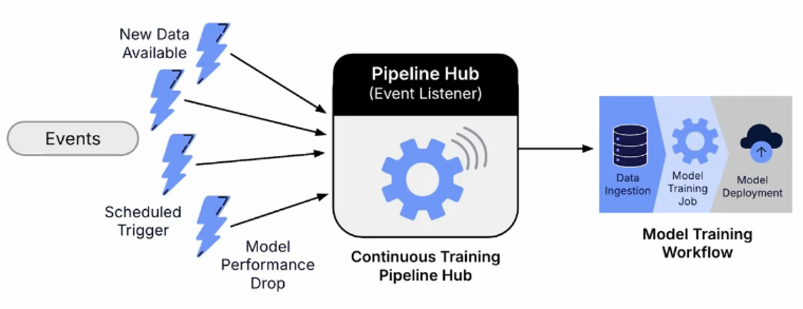
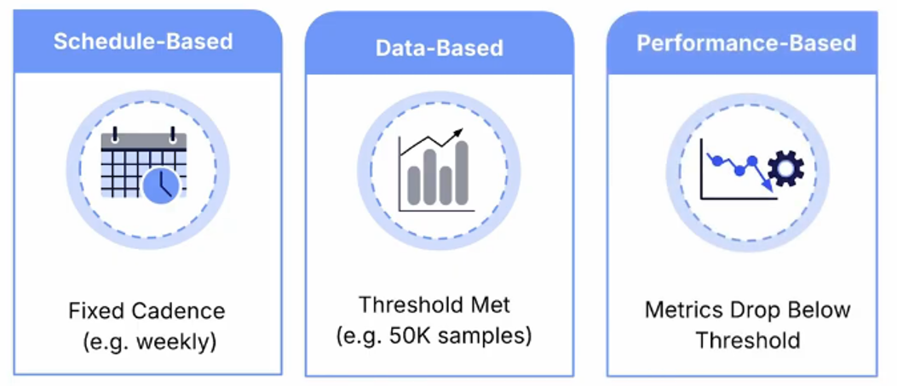
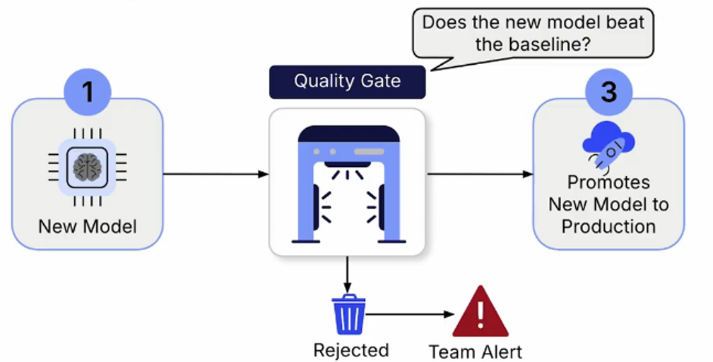
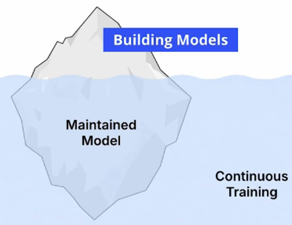

# Continuous Training Pipelines
Continuous training is the process of automatically retraining a machine learning model on new data to maintain its performance and relevance without manual intervention. Its goal is to keep models up to date and prevent performance degradation from affecting users.

A continuous training pipeline is **event-driven**, meaning it automatically starts in response to a specific event or condition known as a **trigger**.

## 1. Common Retraining Triggers

There are three common types of triggers used to initiate continuous training pipelines:

### 1.1 Schedule-Based Triggers
Retraining occurs at fixed intervals, such as daily, weekly, or quarterly. This approach is effective when new data arrives at a predictable rate or when underlying trends change periodically. For example, a real estate price prediction model might be retrained every three months to reflect changing market conditions.

### 1.2 Data-Based Triggers
Retraining begins once a predefined amount of new data has been collected. For example, a pipeline can automatically start training after accumulating 50,000 new samples.

### 1.3 Performance-Based Triggers
Retraining is initiated when a monitoring system detects a significant decline in model performance. For example, if a model's precision drops by 20%, the monitoring system can trigger the pipeline to retrain the model using more recent data.

## 2. The Quality Gate
A quality gate is an automated step in a continuous training pipeline that evaluates a newly trained model against predefined performance criteria before allowing it to be deployed to production.

After training, the new model is compared with the current production model using key performance metrics. Based on the results:
* **If the new model performs better**, it is automatically promoted to production.
* **If the new model performs worse or fails to meet the required criteria**, it is discarded, and the existing production model remains in place.

This process prevents lower-performing models from reaching users while allowing the system to continuously improve and adapt over time.

## 3. Conclusion
Building models is only a fraction of the challenge. Maintaining their intelligence over time is the real work. Continous training is what separates a model that was deployed from a model that is maintained. You are building a system that learns, adapts and improves.

