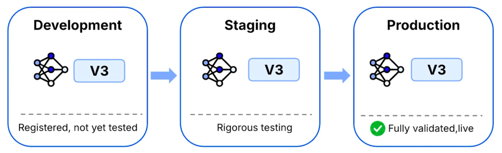
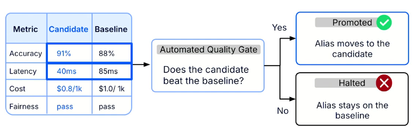

# Model Lifecycle Management

## 1. Model Registry
A model registry is a centralized system for storing, versioning, and managing ml models, acting as a single source of truth between development and deployment environments. It provides a trusted location for trained models that are ready for evaluation, ensuring that the correct model versions are used in production.

Each registered model is:
* **Versioned** to distinguish between different model iterations.
* **Tagged with metadata** to provide relevant information about the model.
* **Linked to its experiment run** to maintain traceability back to the training process.

Instead of manually transferring model files, deployment teams retrieve models directly from the registry. This ensures that ML and deployment teams work from the same authoritative source, reducing the risk of deploying incorrect model versions.

## 2. Model Lifecycle
The model lifecycle defines the stages a ML model passes through, from development and testing to validation and deployment in production. A model registry formalizes this process by managing model versions across distinct stages:
* **Development**: The stage where models are developed and tested.
* **Staging**: A pre-production environment where model candidates are validated before deployment.
* **Production**: The live environment where validated models serve predictions to end-users or other systems.

To manage model transitions, registries use **dynamic aliases** instead of hardcoded version numbers. A dynamic alias is a movable label, such as `production`, that points to a specific model version.

Rather than requesting a fixed version, deployment code retrieves whichever model currently holds the `production` alias. When a better-performing model is validated, the alias can be reassigned to the new version without modifying deployment configurations.

This approach separates deployment infrastructure from model iteration, enabling safer model promotion, seamless rollback, and more reliable deployments.

## 3. Promotion and rollback
To manage these stages smoothly, a registry uses dynamic aliases instead of hardcoded version numbers. Think of an alias as a sticky note labeled "production" that you can move to the best model. Your deployment code simply asks for whatever model currently has the "production" alias.

Promotion should be driven by automated quality gates that compare a candidate model against the current baseline on key metrics. If the new model is better, the registry automatically updates the alias.

If an issue arises post-deployment, a rollback is as simple as moving the alias back to the previous version, providing a fast and reliable recovery.