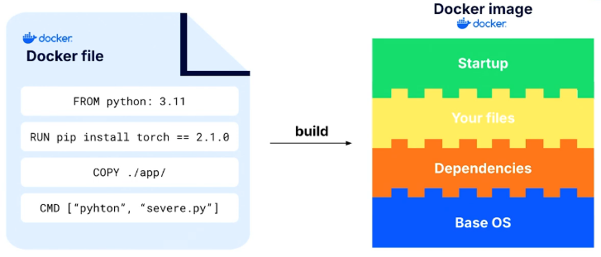
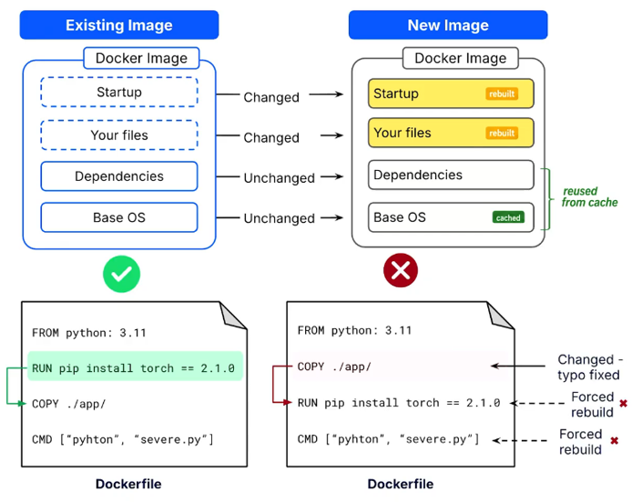
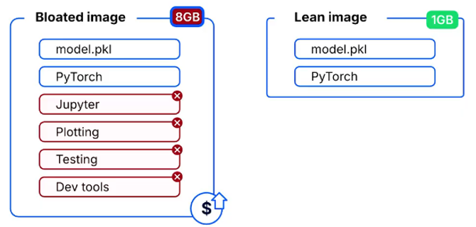
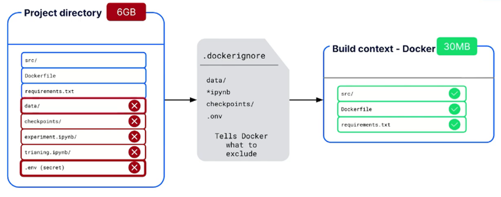
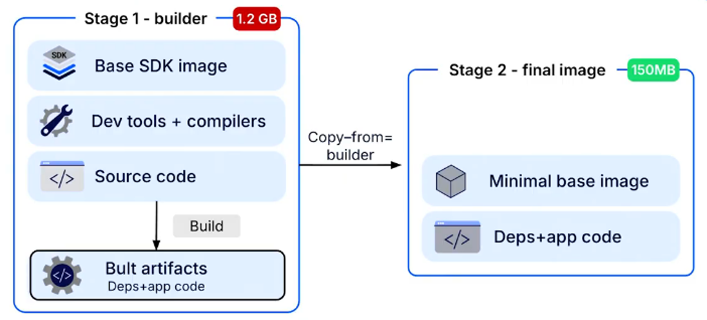

# Model API Containerization
Model API containerization is the process of packaging a ML model's API, application code, and dependencies into a single, isolated unit called a **container**.

A container bundles everything required to run an application, including the programming language version, libraries, and system-level configurations. This ensures consistent behavior across different environments, preventing deployment failures caused by differences in operating systems, package versions, or dependencies.

## 1. How Docker Enables Containerization
**Docker** is an industry-standard tool for creating and managing containers. It uses three key components:
* **Dockerfile**: A plain-text file containing step-by-step instructions for building an application environment, including the base operating system, required dependencies, and application code.
* **Docker Image**: A static, immutable snapshot of the application and its environment, built from the instructions defined in the Dockerfile.
* **Docker Container**: A running instance of a Docker image. Multiple isolated containers can be launched from the same image, each running the application consistently.

By containerizing ML applications with Docker, teams establish a predictable, portable, and repeatable deployment process, reducing environment-related failures.

## 2. Understanding Image Layers
Every command in a `Dockerfile` creates a distinct structural component called a **layer**. A Docker image is built by stacking these layers, starting with a base operating system, followed by dependencies, and finally the application code.



## 3. Techniques for Optimization
Several techniques can be used to create smaller, more efficient Docker images and improve build performance.

### 3.1 Optimize Layer Caching
Docker uses **layer caching** to speed up image builds by reusing previously built layers when their instructions and relevant inputs have not changed.

To take advantage of caching, order layers from least to most frequently changed. Place stable, resource-intensive dependencies early in the `Dockerfile` and frequently modified application code toward the end.

This allows Docker to reuse cached layers instead of rebuilding them unnecessarily, reducing build times.



### 3.2 Remove Unnecessary Dependencies
A production image should contain only the dependencies required to run the application.

Development tools, testing frameworks, and data exploration notebooks should be excluded from the final image. Unused dependencies increase image size, slow startup times, and expand the potential security surface.



### 3.3 Use a `.dockerignore` File
During an image build, the project files included in the **build context** are made available to the Docker builder.

A `.dockerignore` file, similar to `.gitignore`, excludes unnecessary or sensitive files, such as datasets, model checkpoints, and local environment folders, from the build context.

This reduces the amount of data transferred to the builder and improves build efficiency.



### 3.4 Implement Multi-Stage Builds
Multi-stage builds divide a `Dockerfile` into multiple stages to reduce the size of the final image.
* **Builder Stage**: Installs compilers, development tools, and dependencies needed to prepare the application.
* **Final Stage**: Starts from a clean, minimal base image and copies only the essential runtime artifacts from the builder stage.

By excluding build-time dependencies from the final image, multi-stage builds produce significantly smaller and more efficient production images.



## 4. Anatomy Of a Model API Dockerfile
```dockerfile
# Start from a lean, official Python base image
FROM python:3.9-slim

# Set the working directory inside the container
WORKDIR /app

# Copy and install requirements first to leverage caching
COPY requirements.txt .
RUN pip install --no-cache-dir -r requirements.txt

# Copy the rest of the application code
COPY . .

# Command to run the API server when the container starts
CMD ["uvicorn", "main:app", "--host", "0.0.0.0", "--port", "80"]
```