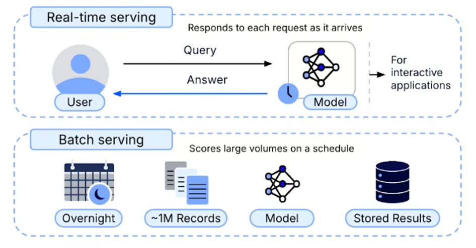

# Model Serving & Scalable Infrastructure
Model serving is the process of making a trained ML model available to generate predictions in a production environment. The serving approach directly affects **latency, cost, and scalability**.

There are two main approaches to model serving: **batch serving** and **real-time serving**.

## 1. Batch Serving
Batch serving processes large volumes of data on a predefined schedule, prioritizing **high throughput and cost-efficiency** rather than immediate responses. A scheduled pipeline loads the model, generates predictions for large datasets, and stores the results in a database for other applications to access later. For example, a model might process millions of records overnight instead of responding to individual requests in real time. This approach offers:
* **High throughput**: Processes large volumes of data efficiently.
* **Cost-efficiency**: Compute resources are used only when batch jobs are running.

## 2. Real-Time Serving
Real-time serving processes individual requests or small batches as they arrive, prioritizing **low latency** for interactive applications that require immediate predictions. For example, a conversational agent must generate responses as users interact with it.

The most common implementation exposes the model through an **API (Application Programming Interface)**, which acts as a structured entry point for receiving requests, validating input data, generating predictions, and formatting responses.

Real-time serving typically involves two layers:
* **API Layer**: Exposes the model over a network and handles request and response logic. Frameworks such as FastAPI can be used to implement this layer.
* **Infrastructure Layer**: Provides the environment where the API runs. Options include serverless platforms like Google Cloud Run and managed ML platforms like AWS SageMaker, which support deployment, scaling, and monitoring.

Unlike batch serving, real-time infrastructure often requires continuously available resources, which can result in higher ongoing costs.

## 3. Scaling Your Serving Infrastructure
Scaling ensures that model-serving infrastructure can handle increasing traffic while maintaining performance and availability.

### 3.1 Vertical Scaling
Vertical scaling increases the computational resources of an existing server, such as its CPU or memory.

Although straightforward to implement, it has hardware limitations and can create a single point of failure.

### 3.2 Horizontal Scaling
Horizontal scaling increases capacity by adding more server instances and distributing incoming traffic across them. This approach improves resilience, availability, and the ability to handle larger workloads. Horizontal scaling typically relies on three key components:
1. **Load Balancers**: A **load balancer** distributes incoming network requests across multiple server instances, preventing any single server from becoming overwhelmed. It provides a single endpoint for clients while managing traffic distribution and monitoring instance health to route requests only to healthy servers.
2. **Health Checks**: A **health check** is a dedicated endpoint used to determine whether a server instance can receive traffic. Two important types of health checks are:
    * **Liveness**: Verifies that the server process is running.
    * **Readiness**: Confirms that the model is fully loaded into memory and ready to generate predictions.
3. **Autoscaling**: It automatically adjusts the number of running server instances based on demand and predefined metrics, such as CPU utilization or request latency. Kubernetes is a standard platform for managing autoscaling in self-managed infrastructure.
    * **When traffic increases**, additional instances are launched to handle the workload.
    * **When traffic decreases**, unnecessary instances are terminated to reduce costs.

## 4. Latency vs. Throughput
* **Latency**: Time to answer one request. For interactive apps.
* **Throughput**: Requests per second. For high-volume apps.

Your choice of infrastructure will depend on the performance you need. You must balance **latency** (how long it takes to respond to one request) with **throughput** (how many requests you can handle per second).