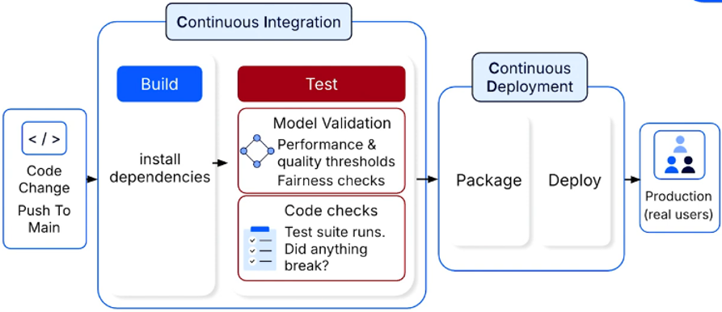
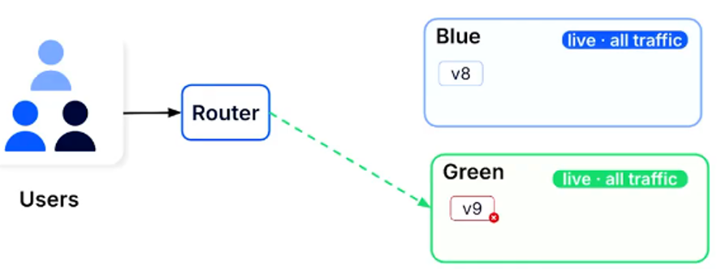
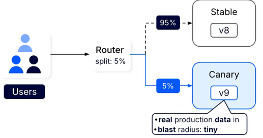
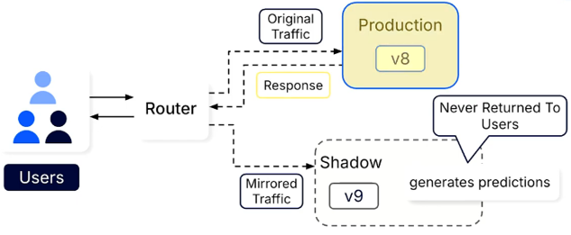
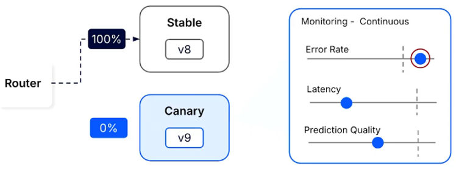

# CI/CD for Deployment
**Continuous Integration (CI) and Continuous Deployment (CD)** is an automated workflow for building, testing, and releasing applications and ML models.

A well-designed CI/CD pipeline provides a systematic, repeatable, and reliable path from development to production, enabling faster deployments while reducing the risk of releasing faulty models.

## 1. Continuous Integration (CI)
**Continuous Integration (CI)** is the practice of frequently merging code changes into a central repository, where automated builds and tests run whenever new changes are pushed.

During this stage, dependencies are installed, the application is built, and automated tests verify that changes have not broken existing functionality.

## 2. Continuous Deployment (CD)
**Continuous Deployment (CD)** automatically packages and releases changes to production once they pass all required CI checks, without manual intervention.

If any stage fails, the pipeline stops, preventing faulty changes from reaching production.

## 3. CI/CD for ML
Unlike traditional software, ML deployment involves both application code and trained models. Even when the code functions correctly, a model may still produce inaccurate, biased, or unreliable predictions.

Therefore, ML CI/CD pipelines include additional **model quality validation gates** after standard code tests.

These automated checks verify that a model meets predefined performance and quality requirements before deployment.

For example, a pipeline might enforce the following conditions:
* **Model Accuracy**: Accuracy on a holdout dataset must exceed 95%.
* **Prediction Latency**: Response time must remain below a 100 ms Service Level Agreement (SLA).
* **Fairness**: Model performance must satisfy fairness requirements across different user segments.

If any validation gate fails, the pipeline halts, blocks deployment, and notifies the team.

## 4. Deployment Strategies
Deployment strategies determine how new model versions are introduced into production while minimizing disruption and risk.

### 4.1 Blue/Green Deployment
**Blue/Green deployment** maintains two identical production environments, typically called *Blue* and *Green*.
* **Active Environment**: Serves all live production traffic.
* **Idle Environment**: Hosts the new model version for final validation before release.

Once the new version is validated, traffic is switched entirely to the updated environment.

The previous environment remains available, enabling immediate rollback by redirecting traffic if problems occur.

The main tradeoff is **higher infrastructure cost**, since two complete production environments must be maintained.

### 4.2 Incremental Release Strategies
Incremental release strategies introduce new model versions gradually or test them against live traffic before exposing users to their predictions.

#### 4.2.1 Canary Deployment
**Canary deployment** gradually releases a new model version to a small subset of users while the majority continue using the stable version.

For example, 5% of production traffic might initially be routed to the new model while its performance is monitored.
* **If performance meets expectations**, traffic is gradually increased until the new model serves all users.
* **If issues are detected**, traffic is redirected to the previous stable version.

This approach minimizes the impact of potential failures during deployment.

#### 4.2.2 Shadow Deployment
**Shadow deployment** sends a copy of live production traffic to a new model while the existing model continues serving predictions to users.

The new model's predictions are not returned to users, allowing its behavior, accuracy, and stability to be evaluated under real-world conditions without affecting the user experience.

Its outputs can be compared against those of the current production model to identify potential issues before release.

Shadow deployment is often performed before a canary deployment.

## 5. Automated Rollback
**Automated rollback** is a deployment safeguard that automatically restores the previous stable model version when monitoring detects failures or performance regressions.

This helps minimize the impact of faulty deployments by quickly reverting to a known working version.

Automated rollback needs:
1. Continous monitoring: catching the signal fast.
2. A stable version still deployed and ready to receive traffic.

