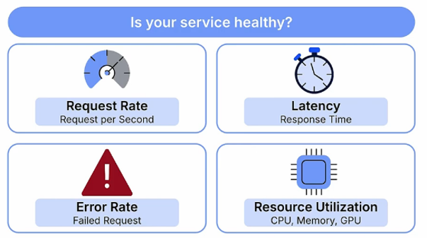
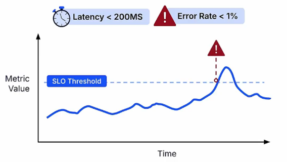
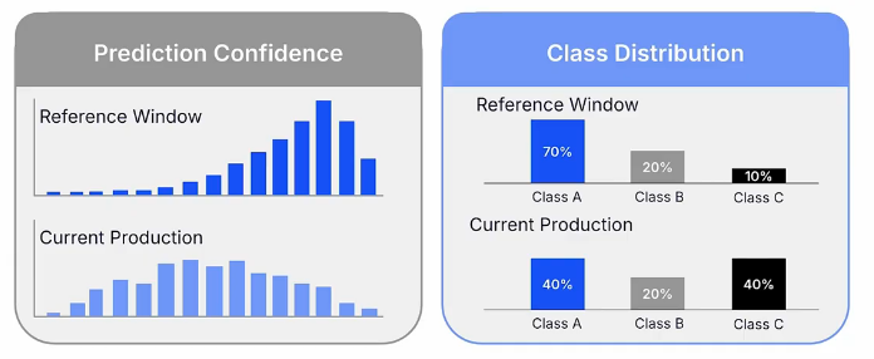

# Model Serving Monitoring
Model serving monitoring ensures that deployed ML systems remain operationally healthy and maintain reliable predictive performance.

Monitoring is divided into two main categories: **service monitoring**, which evaluates the health of the serving infrastructure, and **ML monitoring**, which assesses the model's predictive behavior.

## 1. Service Monitoring
**Service monitoring** tracks software engineering metrics to ensure that the system serving the model remains healthy, available, and responsive.

It focuses on four key metrics:
* **Request Rate**: The number of requests the service processes per second.
* **Latency**: The time required to process and respond to a request.
* **Error Rate**: The percentage of requests that fail.
* **Resource Utilization**: The amount of CPU, memory, and GPU resources consumed by the service.

These metrics are evaluated against predefined **Service Level Objectives (SLOs)**, which specify measurable performance and availability targets.

For example, an SLO might require that 99% of requests have a latency below 200 ms.

When service performance violates these targets, monitoring systems can trigger alerts to notify the team.

## 2. ML Monitoring
**ML monitoring** evaluates whether a deployed model continues to produce reliable predictions over time.

Unlike service monitoring, which focuses on operational health, ML monitoring detects changes in predictive behavior that may occur even when the service is functioning correctly.

Because ground-truth labels are often delayed or unavailable, ML monitoring relies on **proxy signals**—indirect indicators used to estimate potential changes in model performance.

Key proxy signals include:
* **Prediction Confidence**: A decline in the model's average confidence may indicate difficulty handling new or unfamiliar data.
* **Class Distributions**: Changes in the proportions of predicted classes may indicate shifts in real-world data compared to the training distribution.

Monitoring these signals helps identify potential model performance degradation even when direct accuracy measurements are unavailable.

## 3. Common Observability Tools for MLOps
* Prometheus
* Loki
* Grafana