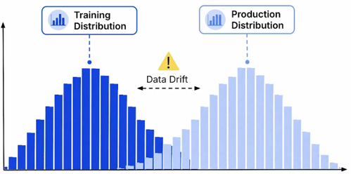

# Data Drift Detection

## 1. Types of Drift
1. **Data drift**: It occurs when the statistical distribution of input features in production changes compared to the data used during training. For example, the average size of houses in a real estate dataset might increase over time, causing the model to receive inputs that differ from its training data.

    

2. **Concept drift**: It occurs when the relationship between input features and the target variable changes over time. For example, during an economic recession, a two-bedroom house might rent for a lower price even though its features remain unchanged.
3. **Label drift**: It occurs when the statistical distribution of the target variable in production changes compared to the training data. For example, a new medical condition might emerge that a diagnostic model has never encountered during training, introducing a previously unseen target class.

## 2. Detecting Drift in Tabular Data
Drift detection compares live production data against **baseline reference data**, a fixed dataset, typically the training or validation set, used as a benchmark for identifying changes in data distributions.

Different statistical tests are used depending on the type of feature being monitored.

### 2.1 Continuous Features
For continuous numerical features, such as price or age, statistical methods measure differences between the reference and production data distributions. Common methods include:
* **Kolmogorov-Smirnov (KS) Test**: Measures the maximum distance between the cumulative distribution functions of the reference and production datasets.
* **Population Stability Index (PSI)**: Measures how much a feature's distribution has shifted across predefined buckets.

### 2.2 Categorical Features
For categorical features, such as `room_type`, the **Chi-Squared Test** can be used to determine whether the proportions of categories have changed significantly.

For example, it can detect changes in the distribution of property types, such as "Entire home" versus "Private room."

## 3. Detecting Drift in Unstructured Data
Detecting drift in unstructured data, such as text or images, requires converting the data into numerical representations before comparing distributions.

**Embeddings** are numerical vector representations of unstructured data that capture meaningful relationships between inputs.

For example, detecting drift in customer reviews involves:
1. **Generate Embeddings**: Convert reference and production text into numerical vectors using an embedding model.
2. **Compare Distributions**: Analyze differences between the reference and production embedding distributions to identify semantic shifts.

The same embedding model must be used for both datasets to ensure a valid comparison.

## 4. Conclusion
Drift detection methods produce numerical scores or statistical results that can be evaluated against predefined thresholds.

When a feature's drift measurement exceeds its threshold, an automated alert can be triggered, indicating that the model's learned patterns may no longer reflect current data.

These alerts can initiate corrective actions, such as retraining the model on more recent data, to maintain reliable predictive performance.