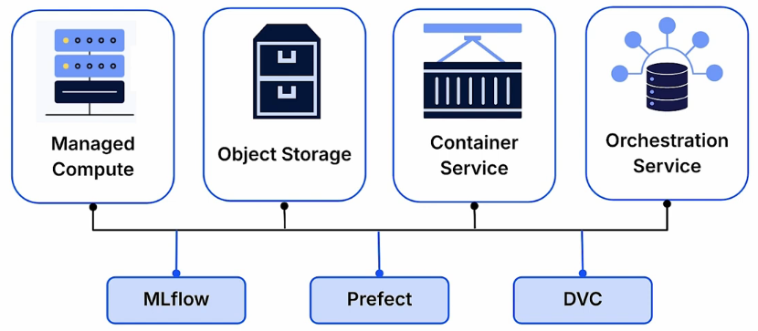
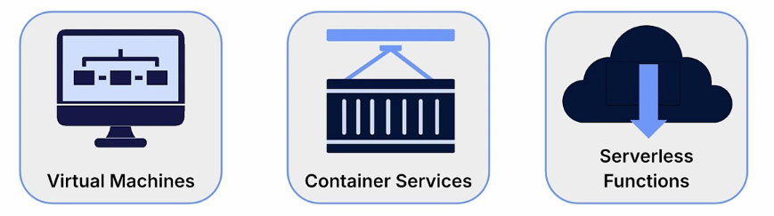
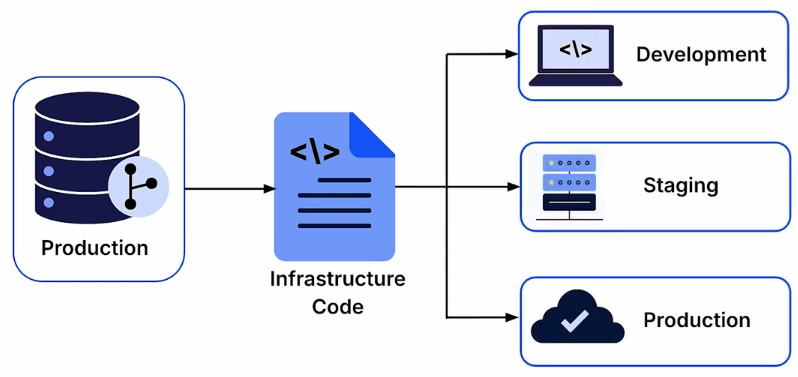

# End-to-End MLOps Architecture
End-to-end MLOps architecture provides the infrastructure and tools needed to manage the ML lifecycle, from data preparation and model training to deployment and monitoring.

## 1. Two Strategies for Cloud MLOps
There are two primary approaches to building a cloud-based MLOps system: using an integrated end-to-end ML platform or composing a custom stack from individual services and tools.

### 1.1 End-to-End ML Platforms
**End-to-end ML platforms** are integrated suites of tools that provide a unified environment for managing the entire machine learning lifecycle.

Examples include:
* Amazon SageMaker
* Google Vertex AI
* Azure Machine Learning

These platforms combine capabilities such as data processing, model training, serving, and monitoring into a single system.

**Advantages:**
* Faster setup and integration.
* Unified management of ML workflows.

**Tradeoff:**
* Less control over how individual components are integrated.

### 1.2 Custom MLOps Stack
A **custom MLOps stack** is an architecture built by combining individual cloud services and open-source tools to meet specific project requirements.

This approach involves selecting services for compute, storage, and orchestration, then integrating them with tools such as MLflow or DVC.

**Advantages:**
* Greater control over infrastructure and component integration.
* Reduced dependence on a single cloud provider.

**Tradeoff:**
* Requires more engineering effort to integrate and maintain the components.

## 2. Core Infrastructure Components
Regardless of the chosen architecture, production MLOps systems rely on four core infrastructure components:
1. **On-demand compute**: It provides computational resources, such as virtual machines or containers, that can be provisioned as needed for individual pipeline tasks. These isolated environments support operations such as data processing and model training, with resources used and paid for only when required.
    
2. **Centralized storage**: It provides a unified repository for datasets, trained models, and other artifacts. Typically implemented using cloud object storage, it acts as a shared handoff point between different components of the ML workflow, ensuring data consistency and accessibility.
3. **Pipeline orchestration** automates and manages the execution of ML workflows, coordinating tasks such as data ingestion, training, and deployment. An **orchestrator** controls task execution, triggers downstream steps, and passes data locations between jobs to ensure a repeatable pipeline.
4. **Identity and Access Management (IAM)**: It controls authentication and permissions for users, services, and infrastructure components. It ensures that interactions with ML resources are authorized and secure by defining precise access permissions.

**Infrastructure as Code (IaC)** is the practice of provisioning and managing infrastructure through machine-readable configuration files instead of manual setup. By storing infrastructure definitions in version control, IaC makes cloud environments:
* **Versioned**: Infrastructure changes are tracked over time.
* **Reviewable**: Configurations can be inspected before changes are applied.
* **Reproducible**: Infrastructure environments can be recreated consistently.

This provides a systematic and reliable way to manage the infrastructure supporting an end-to-end MLOps system.

